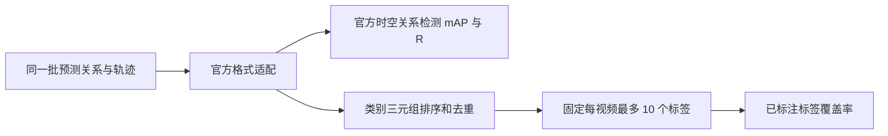

# 面向大创结项的评测与优化记录

追加三个固定测试视频后的更新见 [追加测试与失效分析](additional_test3_analysis.md)。扩大到五视频后，汇总 mAP 为 1.33%、标签覆盖率 @10 为 18.52%；下文保留最早两个样例和开发对照的历史结果。

当前实现可以从“关系标签建议、辅助人工标注”的角度展示效果，完整时空关系检测继续用官方兼容 mAP 衡量。两个任务需要分别命名和报告。已接入固定标签预算的辅助指标，并完成零调用后处理对照、三组真实模型对照和独立片段抽样。

## 当前能够报告的结果

最早 `qwen3.8-flash` 两个测试冒烟视频，共 6 条 Gold 关系：

| 任务与指标 | 实测结果 | 衡量内容 |
| --- | ---: | --- |
| 完整时空关系检测：官方兼容 mAP | 3.33% | 类别、谓词、方向、时空轨迹匹配和排名 |
| 完整时空关系检测：R@50 | 16.67% | 前 50 条时空预测覆盖的 Gold 关系 |
| 视频关系标签识别：官方兼容 Tagging P@1 | 50.00% | 每视频排名第一的类别三元组是否属于已知标签 |
| 已标注关系标签覆盖率 @10 | 50.00% | 每视频最多 10 个去重标签覆盖的已知类别三元组 |

这是两个已检查样例的部分评测，不能视为完整测试集的泛化成绩。原始记录见 `runs/performance_validation_20261002/qwen38_flash_smoke/reports/`；新指标与复算结果在其中的 `completion_eval/`。复算未调用 API，官方匹配门槛仍为 tube vIoU ≥ 0.5。

50% 标签覆盖率没有要求实例 ID、时间区间和框都正确，不能表述为“mAP 提升到 50%”或“标注准确率 50%”。它适合回答：系统提出有限数量的关系建议后，人工能否找到已知关系。精确率和人工采纳率还需完整标注验证。

## 新指标的固定规则

主辅助指标固定为 @10，同时列出 @1、@5、@20，不能事后挑选最好看的预算。所有预先选定的视频都进入评测；没有输出的视频对其已知标签贡献零命中。

预测先经现有官方格式适配器，缺少主语或宾语轨迹的关系不计为可用建议；随后按分数排序，去重相同类别三元组。主语类别、完整谓词、宾语类别及方向必须完全一致，`walk_beneath` 不会因仅识别 `beneath` 而得到完整标签命中。同一关系在多个窗口或多个实例出现时，不会重复占用标签预算。

稀疏 Gold 只支持“已标注标签覆盖率”：未记录的预测可能实际成立，当前不据此报告完整标签精确率或 F1。每个报告保存逐视频前 20 个建议及 @10 缺失标签，便于追溯。

已验证实现位置：`src/vidvrd_auto/evaluation/tagging.py` 的 `evaluate_known_label_coverage`、`write_tagging_report`；`src/vidvrd_auto/evaluation/vidvrd.py` 的 `run_evaluation_suite`；`src/vidvrd_auto/evaluation/cli.py` 的 `main`。方向、重复窗口、失败视频、固定预算和主预算约束由 `tests/test_tagging_evaluation.py` 验证。

代码定位：`src/vidvrd_auto/evaluation/tagging.py:8:1`（指标定义）、`:64:1`（中文报告）；`src/vidvrd_auto/nodes/global_relation.py:176:1`（多时间尺度候选）；`src/vidvrd_auto/relations/candidate_router.py:84:1`（候选保留策略）；`src/vidvrd_auto/prompts/templates.py:46:1`（参照物语义与组合检查）；`experiments/prepare_completion_review.py:14:1`（仅基于元数据的抽样）。

## 低分原因：检测和 Agent 都有贡献

**已验证的检测/轨迹限制。** 骑行测试视频的自行车预测轨迹只覆盖 88 个帧位置，而 Gold 对象持续 150 帧，且部分框存在偏差。当前自行车轨迹的乐观 tube 匹配上界为 0.3771，小于 0.5。这使该视频三条关系即便谓词正确，也无法在当前轨迹下达到官方匹配门槛。上界是诊断，不是已取得召回率。

**已验证的关系输出限制。** 狗测试视频缺 `run_behind` 与 `front`，正确 `bite` 被重复关系片段挤到第 5 名。新开发对照中，将正确候选覆盖率补到 100% 后，最终仍缺相同的 7 条 Gold 关系；三组原始响应的动作校验拒绝数均为 0。不能将这些漏项归因于解析器丢弃正确响应。

**已验证的时间跨度限制。** 30 帧合并上限对部分短关系有利，却妨碍 150 帧持续关系。放开上限在两个已检查测试样例上提高排名，但无法修复骑行视频的轨迹覆盖；对其他开发样例还可能合并过长。没有统一扩大或缩小时间区间的可靠收益。

依据：现有测试报告的 `track_ceiling_diagnostic`、`error_diagnostics`；本轮 `runs/performance_validation_20261002/optimization_comparison.json`；实现见 `evaluation/track_ceiling.py`、`evaluation/official/vidvrd.py`、`nodes/global_relation.py`。这些诊断只读取最终预测和 Gold；预测流程未读取测试标签。

## 后处理实验：保留结果，不替换默认方案

实验保留短窗口和连续事件长区间，并降低同一事件的次要区间分数。仅依据已有预测、证据断点和轨迹跳变生成候选，未使用 Gold 的时间边界。方案固定在 `experiments/multiscale_policy_20261002.json`，实现为 `nodes/global_relation.py` 的 `_multiscale_proposals`。

| 相同缓存输出上的评测组 | 原 30 帧聚合 mAP | 长短区间与去重排序 mAP |
| --- | ---: | ---: |
| 两个旧开发案例，Qwen 3.7 输出 | 9.15% | 6.16% |
| 两个已检查测试案例，Qwen 3.8 输出 | 3.33% | 8.33% |

两组均关闭最终复核，其他条件不变，新增 API 调用为 0。测试样例已被检查，属于回看回归，不是新的盲测；两个数据组与模型也不同，不能混成一个总体提升结论。开发组退化，因此 `experimental_multiscale.json` 保持可选，默认聚合未替换。

## 候选与提示词真实对照

单纯把候选从 24 增到 32，开发案例的路由覆盖率仍为 10/15。进一步定位发现，跟随镜头会压低目标在屏幕中的位移，原路由在多个动作得分接近时，没有保留完整的动作假设。

新增实验策略为有空间方向支持的轴保留 ontology 中的全部运动动作候选及两个姿态候选，仍使用 24 个候选，不按物体类别强制输出关系。该策略的开发路由覆盖率为 15/15，但路由覆盖不等于最终识别正确。

另一个实验将提示词中的宾语定义从“被动作作用的对象”改为“关系参照物”，让模型独立检查主体动作、姿态、空间关系及两个方向。组合谓词仍必须在候选表内且有视觉证据，不从 Gold 或规则自动补成。

两视频均来自 Gold train。三组都使用 `qwen3.8-flash`、关闭思考，冻结相同检测，并关闭最终复核。检测、轨迹、初始故事板及非候选 packet 内容的 SHA256 一致，三组动作校验拒绝均为 0：

| 方案 | 官方兼容 mAP | R@50 | Tagging P@1 | 标签覆盖率 @10 | API 次数 | 墙钟秒 |
| --- | ---: | ---: | ---: | ---: | ---: | ---: |
| 当前候选与提示词 | 12.55% | 46.67% | 100% | 50% | 8 | 109 |
| 保留动作候选 | 11.97% | 46.67% | 100% | 50% | 8 | 119 |
| 动作候选 + 修正参照物定义 | 13.57% | 40.00% | 100% | 50% | 8 | 151 |

第三组 mAP 提高但召回率降低，标签覆盖没有改善，尚未找到全面提升的方案。保留 `experimental_axis_motion.json`、`experimental_compositional.json` 供继续验证，默认配置未替换；不能拿开发组的 100% P@1 代替测试组的 50%。

每个方案只做一次真实调用，未固定服务端采样 seed。三种配置不是同一配置的三次稳定性重复，且只有两个开发视频。这轮结果用于定位问题，不能证明统计显著的收益。

三组共 24 次请求、24 次尝试，全部成功，无重试、无配额或内容检查错误；输入 token 327266、输出 token 26509，总计 353775。实际账单费用未知，不能按免费处理。配置与预测依据分别记录在 `experiments/axis_motion_policy_20261002.json`、`experiments/compositional_policy_20261002.json`；逐次请求和控制变量证据见 `optimization_comparison.json` 及三组运行目录。

## 结项阶段的完整评测样本

已准备 `runs/completion_review_v1/clips.json` 与 `protocol.json`：使用固定 10 个测试视频，每视频选择一段 60 帧片段，较短视频取全长。起点通过固定 seed 与 video ID 的 SHA256 决定，只读取视频元数据，不按 Gold 关系区间选样。两个已检查视频明确标记，其余八个视频未用于上述调参。

目前片段均为 `annotation_complete=false`，没有虚构新的 Gold 或 F1。需独立完整标注片段中的对象实例、每帧框和所有关系，之后用对应的新 Gold 配合 `--presence-clips` 运行 Presence 实例对 P/R/F1。

结项报告可组织为：关系标签建议的有限预算覆盖率；完整短片段的实例对 Presence P/R/F1；人工采纳率和修改耗时；官方兼容 mAP；调用完成率、耗时、token 与实际费用。人工节时比较须包含审核、补漏和纠错时间，并与同类片段的从零标注对照。若立项书承诺了具体官方指标，该指标仍须如实对照。

抽样实现：`experiments/prepare_completion_review.py`；固定片段 Presence 实现：`evaluation/presence.py`；调用统计：`evaluation/runtime.py`。新建片段清单不代表已完成完整人工评测。

## 验证

158 项 unittest 已通过，包含初始与补帧提示词配置透传、四个方向的运动候选保留、长短候选断点与重复边界、标签方向和固定预算、请求子集与完整范围分母区分、成功流程空输出统计。真实对照确认三组输入一致、无动作校验丢弃；所有实验调用和费用未知状态保存在报告中。
